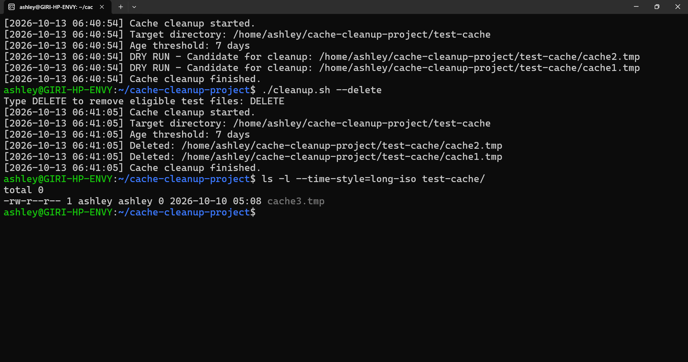

# Linux Cache Cleanup Script

## 1. Project Overview

The Linux Cache Cleanup Script is a Bash-based utility designed to identify old temporary files and support controlled cleanup.

The current version is a local learning prototype tested in Ubuntu on WSL (Windows Subsystem for Linux). It uses a dedicated test directory and does not target real system cache directories.

## 2. Objectives

- Identify temporary `.tmp` files older than a configurable age threshold.
- Preview eligible files before deletion.
- Require explicit confirmation before deleting files.
- Record script activity in a timestamped log file.
- Practise Linux administration and Bash scripting fundamentals.

## 3. Technologies Used

- Operating system: Ubuntu on WSL
- Scripting language: Bash
- Linux utilities: `find`, `date`, `tee`, and `rm`
- Editor: Nano
- Logging: Plain-text log file

## 4. Project Structure

```text
cache-cleanup-project/
├── cleanup.sh
├── cleanup.log
├── README.md
└── test-cache/
    ├── cache2.tmp
    └── cache3.tmp
```

*Note: The test files shown above reflect the expected directory contents after the successful deletion test. The log file is generated when the script runs.*

## 5. Current Functionality

### Dry-run mode

Runs the script without an argument:

```bash
./cleanup.sh
```

The script lists eligible files without deleting them.

### Confirmed deletion mode

Runs the script with:

```bash
./cleanup.sh --delete
```

The script requests confirmation before deleting eligible files.

### Logging

The script records timestamps, cleanup activity, candidate files, cancellations, and deletion results in `cleanup.log`.

View the log using:

```bash
cat cleanup.log
```

View the test directory using:

```bash
ls -l test-cache
```

## 6. File Selection Rules

The current prototype checks:

- The designated local test directory.
- Regular files directly inside that directory.
- Files with the `.tmp` extension.
- Files older than the configured seven-day threshold.

These rules are for learning and testing only. They are not yet a verified policy for cleaning actual Linux server caches.

## 7. Testing and Results

The following tests have been performed:

- Confirmed that the script identifies the eligible test file.
- Confirmed that dry-run mode leaves files untouched.
- Confirmed that cancelling the deletion prompt prevents deletion.
- Confirmed that explicitly approving deletion removes the eligible test file.
- Confirmed that the log records the deletion with a timestamp.
- Confirmed that newer test files remain in the directory.

## 8. Project Output

The screenshot below demonstrates the cache cleanup script's dry-run and deletion workflows in Ubuntu on WSL.

- **Dry run:** Identifies eligible `.tmp` files without deleting them.
- **Confirmed deletion:** Removes eligible files only after explicit confirmation.
- **Verification:** Confirms that the newer test file remains untouched.



## 9. Safety Considerations

- The default mode is dry-run.
- Deletion requires explicit confirmation.
- Testing is restricted to a dedicated local test directory.
- Real system cache directories must not be targeted until the requirements and retention policy are confirmed.
- Application cache files, temporary files, and package-manager caches have different purposes and must not be treated as interchangeable.
- Production use requires additional testing, error handling, and review of directory and permission safeguards.

## 10. Future Improvements

- Confirm the target cache directories and file types.
- Make the retention period configurable.
- Add a summary of files found, deleted, and skipped.
- Improve path validation and deletion safeguards.
- Test error handling and unusual filenames.
- Document deployment and execution on an AWS EC2 Linux instance.
- Consider scheduled execution only after the cleanup policy is approved.

## 11. Author and Project Status

**Project:** Linux Cache Cleanup Script 
**Status:** Local prototype — initial tests completed 
**Environment:** Ubuntu on WSL 
**Next milestone:** Confirm the server cleanup requirements and harden the script before AWS deployment.
